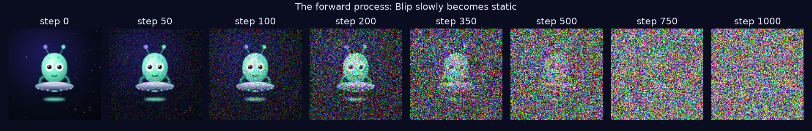
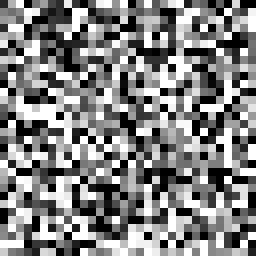

# Diffusion from scratch

How do image generators turn random static into a picture? This repo walks through it step by step, with small runnable notebooks and every picture already rendered, so you can follow along right here on GitHub.

It's a companion to my notes on diffusion models. The step-by-step version lives on my site: **[rohit-shroff.vercel.app/lab/diffusion](https://rohit-shroff.vercel.app/lab/diffusion)**.



## The steps

| | Notebook | What you'll see |
|---|---|---|
| 1 & 2 | [Images are numbers, and adding noise](notebooks/01_images_and_noise.ipynb) | An image as grids of numbers, then Blip (my portfolio's alien) dissolving into static over 1,000 small steps. No AI yet. |
| 3 | [Training: learning to guess the noise](notebooks/02_training.ipynb) | A small model learns to guess the noise hidden in noisy handwritten digits. About 10 minutes on a laptop. |
| 4 & 5 | [Generating: from static to a digit](notebooks/03_generating.ipynb) | Starting from pure static, the model removes a slice of noise at a time until a digit appears, plus small experiments for the questions I had while learning. |

<p align="center">
  
</p>

## The idea in five lines

1. **An image is numbers**: a grid of pixel brightness values (three grids for colour).
2. **Forward process**: add a little random noise, 1,000 times, until it's pure static. It's a fixed recipe, so we always know how much noise went in.
3. **Training**: show the model a noisy image and ask it to guess the noise. We hold the answer key, so the error tells it how to adjust its dials.
4. **Generating**: start from static, guess the noise, remove a small slice, repeat. Big shapes first, details last.
5. **Guidance**: a label (or, in real image generators, a text prompt turned into numbers) steers every step toward what you asked for.

## Run it yourself

```bash
python3 -m venv .venv
source .venv/bin/activate
pip install -r requirements.txt
jupyter notebook notebooks/
```

Run the notebooks in order. Notebook 02 trains the model and saves it to `checkpoints/`. The trained model is already included, so you can skip straight to 03 if you like.
It runs on an Apple Silicon Mac (uses the GPU via MPS), an NVIDIA GPU, or the CPU (slower).

## What's inside

- `diffusion/schedule.py`: the noise recipe (how much noise at each step)
- `diffusion/model.py`: a small U-Net (~0.65M parameters) that guesses noise, told the step number and the requested digit
- `notebooks/`: the three steps, with outputs saved
- `outputs/`: every figure and animation the notebooks make
- `checkpoints/tiny_unet_mnist.pt`: the trained model

The digits come from the [MNIST](https://en.wikipedia.org/wiki/MNIST_database) dataset, downloaded automatically by torchvision.
